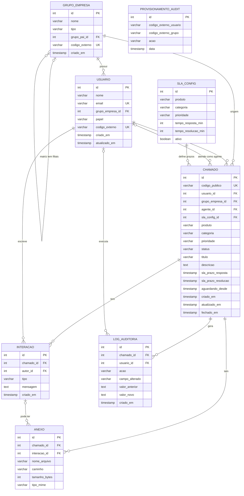

# 03 — Análise, Design e Dados

## 4.1 Arquitetura do Sistema

Desacoplada: React (web) → API C#/.NET → PostgreSQL + webhooks/n8n → Portal.

Fluxo: Portal Atos Capital → API Chamados → PostgreSQL → webhooks → Portal. Portal inicia com JWT; API valida, upsert usuário/grupo, serve abertura/acompanhamento. React consome API. n8n orquestra webhooks/alertas e futuras integrações (e-mail, WhatsApp). Expansível sem reconstruir núcleo.

`[ESPAÇO RESERVADO DIAGRAMA ARQUITETURA]`

## 4.2 Modelo do Domínio

- **Usuario** (id, nome, email, papel, grupoEmpresa, criadoEm/atualizadoEm): `eCliente()`, `eAgenteOuSuperior()`, `pertenceAoGrupo()`, `possuiPermissao()`.
- **GrupoEmpresa** (cod, nome, tipo MATRIZ/FILIAL, criadoEm): auto `grupoPai/filiais`; `eMatriz()`, `eFilial()`, `obterGrupoPai()`, `adicionarFilial()`.
- **Chamado** (cod, codigoPublico, produto, categoria, prioridade, status, título, descrição, slaPrazos, aguardandoDesde, datas): `reativar()`, `fecharPorInatividade()`, `estaEstouradoSLA()`, `atribuirAgente()`, `alterarStatus()`.
- **Interacao** (cod, tipo PUBLICA/INTERNA, mensagem, criadoEm): `eNotaInterna()`, `possuiAnexos()`, `anexarArquivos()`.
- **Anexo** (cod, nome, caminho, tamanhoBytes, tipoMime): valida extensão/tamanho/vínculo.
- **SlaConfig** (cod, produto, categoria, prioridade, tempoRespostaMin/ResolucaoMin, ativo): `atendeRegra()`, `calcularPrazo*()`, `estaAtivo()`.
- **LogAuditoria** (cod, acao, campo, anterior/novo, criadoEm): `registrarAlteracao()`, etc.

## 4.3 Interação / Sequência

Priorizados: abertura (UC01+UC10), sincronização (UC10), status (UC04a), reativação (UC04b), inatividade (UC04c), pública/interna (UC05), webhook (UC06), SLA (UC07b/UC09).

Sequência abertura/atendimento: Cliente → Portal (JWT+grupo) → API (valida JWT, UC10 upsert, valida, cria Aberto+codigoPublico, UC13, UC06) → retorna ID. Agente assume (UC03a/b), status (UC04a+UC13+UC06), notas (UC05), job SLA (UC07b→UC09).

`[ESPAÇO RESERVADO DIAGRAMA SEQUÊNCIA]`

## 4.4 Diagrama de Classes (Figura 2)

Pacotes Governança, Acesso, Atendimento, Enumerações. Conforme modelo lógico §4.8 + scripts versionados.

Leitura: Cliente (Usuario 0.._) abre Chamados; Agente (0..1) atende; Chamado 1—0.._ Interacao; Chamado/Interacao 1—0.._ Anexo; Usuario 0.._—0..1 GrupoEmpresa (matriz/filial); Chamado 0.._—1 SlaConfig; Chamado 1—0.._ LogAuditoria. Enums: Prioridade (BAIXA/MEDIA/ALTA/URGENTE), TipoGrupo (MATRIZ/FILIAL), PapelUsuario (CLIENTE/AGENTE/SUPERVISOR/ADMIN), StatusChamado (FECHADO/ABERTO/EM_ANDAMENTO/AGUARDANDO_CLIENTE/RESOLVIDO), TipoInteracao (PUBLICA/INTERNA).

Figura 2 – Diagrama de Classes da Plataforma de Suporte (pacotes Governança, Acesso, Atendimento e Enumerações).

> 

## 4.5 Atividades

Fluxo abertura→fechamento com decisões manual/auto, espera cliente, resolução, encerramento normal/inatividade + UC13, UC06, UC07b/UC09.

> 

## 4.6 Estados

`ABERTO → EM_ANDAMENTO → AGUARDANDO_CLIENTE → RESOLVIDO → FECHADO`. Transições: atribuir (UC03a/b), responder (UC04a/b), solicitar cliente, reativar, inatividade (UC04c).

> 

## 4.6 (bis) Componentes

Mínimo: Portal, React, API .NET, PostgreSQL, JWT, webhooks, n8n. Dependências: React→API (HTTPS/JSON Swagger); API→PostgreSQL; API→Portal (webhooks); n8n→API/canais. `[ESPAÇO RESERVADO]`

## 4.7 Modelo de Dados

> Atualizado conforme o código-fonte (entidades do `SupportAtos.Domain`, configurações do EF Core e migrations `InitialCreate`, `AddPortalExternalId` e `AlinharAoSqlOficial`). O banco é PostgreSQL e o esquema é criado e versionado pelas migrations do .NET.

### 4.7.1 Lógico

O modelo tem **8 tabelas**:

- **grupo_empresa**: matriz ou filial, com autorrelacionamento (`grupo_pai_id`) e código externo vindo do portal (`codigo_externo`, único).
- **usuario**: pertence a um grupo empresa; tem papel e código externo do portal (`codigo_externo`, único). O e-mail é único.
- **sla_config**: prazos de resposta e resolução, únicos por (produto, categoria, prioridade).
- **chamado**: aberto por um usuário (`usuario_id`), atendido por um agente opcional (`agente_id`), vinculado a um grupo empresa e a uma regra de SLA. O `codigo_publico` é único.
- **interacao**: mensagem de um chamado, pública ou nota interna, escrita por um autor (`autor_id`).
- **anexo**: arquivo de um chamado, opcionalmente ligado a uma interação.
- **log_auditoria**: trilha de alterações do chamado (ação, campo, valor anterior e novo).
- **provisionamento_audit**: registro da sincronização usuário/grupo vinda do portal (RF10). Não tem chave estrangeira; guarda os códigos externos como texto.

Os campos de papel, status, prioridade e tipo de interação são gravados como **texto** (`varchar`), com o nome do valor do enum do C# (por exemplo `EmAndamento`, `NotaInterna`).

### 4.7.2 Diagrama Entidade-Relacionamento

Legenda: `PK` chave primária, `FK` chave estrangeira, `UK` valor único. Todas as chaves primárias são `integer` com geração automática (identity).

### 4.7.3 Dicionário de dados

#### grupo_empresa

| Campo          | Tipo               | Chave                 | Obrigatório | Observação                         |
| -------------- | ------------------ | --------------------- | ----------- | ---------------------------------- |
| id             | integer (identity) | PK                    | sim         |                                    |
| nome           | varchar(150)       |                       | sim         |                                    |
| tipo           | varchar(20)        |                       | sim         | Padrão `matriz` (matriz ou filial) |
| grupo_pai_id   | integer            | FK → grupo_empresa.id | não         | Preenchido nas filiais             |
| codigo_externo | varchar            | UK                    | não         | Identificador no portal            |
| criado_em      | timestamp          |                       | sim         |                                    |

#### usuario

| Campo            | Tipo               | Chave                 | Obrigatório | Observação                                 |
| ---------------- | ------------------ | --------------------- | ----------- | ------------------------------------------ |
| id               | integer (identity) | PK                    | sim         |                                            |
| nome             | varchar(150)       |                       | sim         |                                            |
| email            | varchar(255)       | UK                    | sim         |                                            |
| grupo_empresa_id | integer            | FK → grupo_empresa.id | sim         |                                            |
| papel            | varchar(20)        |                       | sim         | `Cliente`, `Agente`, `Supervisor`, `Admin` |
| codigo_externo   | varchar            | UK                    | não         | Identificador no portal                    |
| criado_em        | timestamp          |                       | sim         |                                            |
| atualizado_em    | timestamp          |                       | não         |                                            |

#### sla_config

| Campo               | Tipo               | Chave       | Obrigatório | Observação                             |
| ------------------- | ------------------ | ----------- | ----------- | -------------------------------------- |
| id                  | integer (identity) | PK          | sim         |                                        |
| produto             | varchar(100)       | UK composta | sim         | Única junto com categoria e prioridade |
| categoria           | varchar(100)       | UK composta | sim         |                                        |
| prioridade          | varchar(20)        | UK composta | sim         | `Baixa`, `Media`, `Alta`, `Urgente`    |
| tempo_resposta_min  | integer            |             | sim         | Em minutos                             |
| tempo_resolucao_min | integer            |             | sim         | Em minutos                             |
| ativo               | boolean            |             | sim         | Padrão `true`                          |

#### chamado

| Campo               | Tipo               | Chave                 | Obrigatório | Observação                                                           |
| ------------------- | ------------------ | --------------------- | ----------- | -------------------------------------------------------------------- |
| id                  | integer (identity) | PK                    | sim         |                                                                      |
| codigo_publico      | varchar(20)        | UK                    | sim         | Código exibido ao cliente                                            |
| usuario_id          | integer            | FK → usuario.id       | sim         | Quem abriu                                                           |
| grupo_empresa_id    | integer            | FK → grupo_empresa.id | sim         |                                                                      |
| agente_id           | integer            | FK → usuario.id       | não         | Agente responsável                                                   |
| sla_config_id       | integer            | FK → sla_config.id    | sim         |                                                                      |
| produto             | varchar(100)       |                       | sim         |                                                                      |
| categoria           | varchar(100)       |                       | sim         |                                                                      |
| prioridade          | varchar(20)        |                       | sim         | `Baixa`, `Media`, `Alta`, `Urgente`                                  |
| status              | varchar(30)        |                       | sim         | `Aberto`, `EmAndamento`, `AguardandoCliente`, `Resolvido`, `Fechado` |
| titulo              | varchar(200)       |                       | sim         | Obrigatório (RF05)                                                   |
| descricao           | text               |                       | sim         |                                                                      |
| sla_prazo_resposta  | timestamp          |                       | não         |                                                                      |
| sla_prazo_resolucao | timestamp          |                       | sim         |                                                                      |
| aguardando_desde    | timestamp          |                       | não         | Usado no encerramento por inatividade                                |
| criado_em           | timestamp          |                       | sim         |                                                                      |
| atualizado_em       | timestamp          |                       | não         |                                                                      |
| fechado_em          | timestamp          |                       | não         |                                                                      |

#### interacao

| Campo      | Tipo               | Chave           | Obrigatório | Observação                 |
| ---------- | ------------------ | --------------- | ----------- | -------------------------- |
| id         | integer (identity) | PK              | sim         |                            |
| chamado_id | integer            | FK → chamado.id | sim         |                            |
| autor_id   | integer            | FK → usuario.id | sim         |                            |
| tipo       | varchar(20)        |                 | sim         | `Publica` ou `NotaInterna` |
| mensagem   | text               |                 | sim         |                            |
| criado_em  | timestamp          |                 | sim         |                            |

#### anexo

| Campo         | Tipo               | Chave             | Obrigatório | Observação              |
| ------------- | ------------------ | ----------------- | ----------- | ----------------------- |
| id            | integer (identity) | PK                | sim         |                         |
| chamado_id    | integer            | FK → chamado.id   | sim         | Exclusão em cascata     |
| interacao_id  | integer            | FK → interacao.id | não         |                         |
| nome_arquivo  | varchar(255)       |                   | sim         |                         |
| caminho       | varchar(500)       |                   | sim         | Local ou URL do arquivo |
| tamanho_bytes | integer            |                   | sim         |                         |
| tipo_mime     | varchar(100)       |                   | não         |                         |

#### log_auditoria

| Campo          | Tipo               | Chave           | Obrigatório | Observação                |
| -------------- | ------------------ | --------------- | ----------- | ------------------------- |
| id             | integer (identity) | PK              | sim         |                           |
| chamado_id     | integer            | FK → chamado.id | sim         |                           |
| usuario_id     | integer            | FK → usuario.id | não         | Vazio em ações do sistema |
| acao           | varchar(50)        |                 | sim         |                           |
| campo_alterado | varchar(100)       |                 | não         |                           |
| valor_anterior | text               |                 | não         |                           |
| valor_novo     | text               |                 | não         |                           |
| criado_em      | timestamp          |                 | sim         |                           |

#### provisionamento_audit

| Campo                  | Tipo               | Chave | Obrigatório | Observação |
| ---------------------- | ------------------ | ----- | ----------- | ---------- |
| id                     | integer (identity) | PK    | sim         |            |
| codigo_externo_usuario | varchar            |       | sim         | Sem FK     |
| codigo_externo_grupo   | varchar            |       | sim         | Sem FK     |
| acao                   | varchar            |       | sim         |            |
| data                   | timestamp          |       | sim         |            |

Exclusão: todas as chaves estrangeiras usam `NO ACTION`, exceto `anexo.chamado_id`, que usa `CASCADE`.

## 4.8 Ambiente

Back-end C#/.NET; React; PostgreSQL; n8n; Swagger/OpenAPI; Git.

## 4.9 Externos

- Portal: JWT + recebe webhooks.
- SSO/JWT: upsert UC10.
- Webhooks: criado/atualizado/aguardando/fechado com retry/log UC06.
- n8n: alertas UC09, webhooks, futuro e-mail/WhatsApp.
- PostgreSQL, Swagger/OpenAPI.
